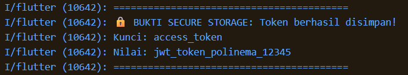

# Laporan Praktikum Week 6 - Campus Notification App

## 1. Detail Implementasi Proyek
| Kategori | Keterangan Lengkap |
| :--- | :--- |
| **Tujuan Proyek** | Mengimplementasikan sistem autentikasi, penyimpanan kredensial token JWT yang aman, dan integrasi penuh Firebase Cloud Messaging (FCM) pada aplikasi Flutter. |
| **Stack Teknologi** | • **Framework:** Flutter • **State Management:** Riverpod • **Routing:** go_router • **Keamanan:** flutter_secure_storage • **Notifikasi:** firebase_messaging, flutter_local_notifications • **HTTP Client:** Dio |
| **Fitur Utama** | 1. *Mock Authentication* dengan perlindungan navigasi (*Guard Route*). 2. *Secure Storage* untuk menyimpan *Access Token* agar aman dari pencurian data. 3. Integrasi *Push Notification* FCM yang berjalan lancar di 3 *App State*. 4. *Deep Linking* dari *banner* notifikasi langsung menuju rute spesifik (`/pengumuman/:id`). 5. *Unit Testing* untuk menguji parsing rute tanpa inisialisasi Firebase sungguhan. |
| **Lampiran Pengujian** | Seluruh bukti *screenshot* (5 skenario pengujian) tersimpan pada direktori `screenshots/`. |

## 2. Tabel Skenario & Pengujian Notifikasi (Deep Linking)
Berikut adalah hasil pengujian klik notifikasi dari ketiga *state* aplikasi dengan *payload* rute spesifik:

| State Aplikasi | Skenario Kondisi & Aksi | Hasil Ekspektasi & Sistem | Status | Bukti Screenshot |
| :--- | :--- | :--- | :--- | :--- |
| **Foreground** | Aplikasi sedang dibuka/aktif. Pesan dikirim dari Firebase. | Notifikasi lokal (banner manual) muncul. | ✅ Berhasil |  |
| **Background** | Aplikasi di-*minimize* (berada di *home screen*). Pesan dikirim. | Banner bawaan OS muncul, klik narik aplikasi ke depan. | ✅ Berhasil |  |
| **Terminated** | Aplikasi ditutup paksa (*swipe* dari *recent apps*). Pesan dikirim. | Aplikasi melakukan *cold boot* dari notifikasi. | ✅ Berhasil |  |

## 3. Tugas Refleksi
| Pertanyaan Refleksi | Analisis & Jawaban Teknis |
| :--- | :--- |
| **Mengapa refresh token tidak boleh disimpan di SharedPreferences? Apa risikonya bila bocor?** | `SharedPreferences` menyimpan data secara *plaintext* (teks biasa yang tidak dienkripsi). Jika perangkat pengguna di-*root* atau terinfeksi *malware*, peretas dapat dengan mudah membaca isi *storage* tersebut. Karena *refresh token* berumur sangat panjang, peretas dapat menggunakannya untuk me-*request* *access token* baru secara terus-menerus dan membajak sesi akun mahasiswa sepenuhnya tanpa ketahuan. Oleh karena itu, wajib menggunakan *library* terenkripsi seperti `flutter_secure_storage`. |
| **Apa yang rusak bila `onTokenRefresh` diabaikan selama satu semester perkuliahan?** | Token FCM dapat sewaktu-waktu kedaluwarsa, menjadi tidak valid karena pembaruan sistem/aplikasi, atau dipulihkan oleh OS. Jika fungsi `onTokenRefresh` diabaikan, aplikasi tidak akan pernah mengirimkan token FCM yang baru ke *backend* kampus. Akibatnya, *backend* akan terus mengirimkan *push notification* ke token lama yang sudah mati. Mahasiswa tersebut akan mengalami kegagalan sistem dan tidak menerima satupun pengumuman penting (seperti perubahan jadwal, rilis nilai, dll) selama satu semester. |

### Bukti Penyimpanan Token (Secure Storage)
