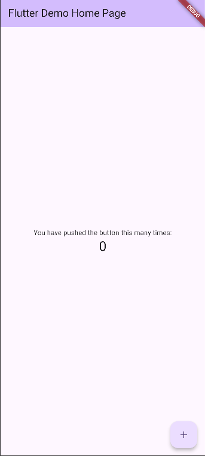
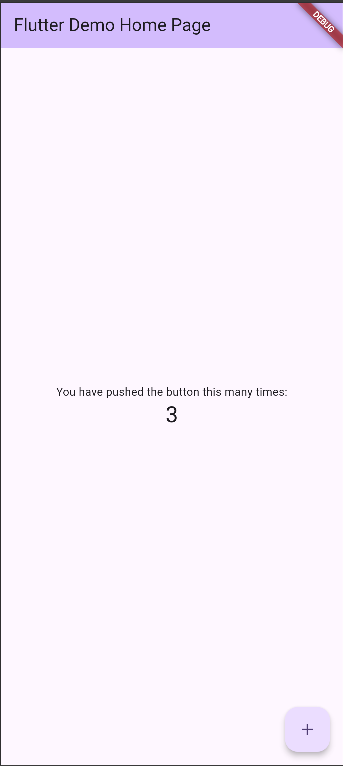
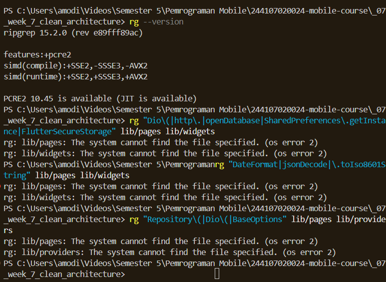
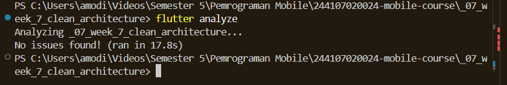

# 🚀 Laporan Refactoring Clean Architecture Flutter

## 🛠️ Praktikum 1: Audit Layer Project Lama

Sebelum refactoring, dilakukan pemetaan masalah pada struktur kode lama untuk mengidentifikasi pelanggaran prinsip arsitektur:

| File Lama | Layer Saat Ini | Masalah (Pelanggaran Clean Architecture) |
| :--- | :--- | :--- |
| `pages/home_page.dart` | Presentation | Memanggil Dio/DB langsung, format tanggal, & parsing mentah di UI. |
| `data/api_client.dart` | Data | OK jika hanya dipanggil oleh repository, bukan oleh widget. |
| `providers/auth_provider.dart` | Presentation | OK jika hanya memanggil repository / use case. |
| `data/auth_repository.dart` | Data | Kontrak (Interface) dan implementasi logika masih tergabung dalam satu kelas. |

### Bukti Tiga Grep Sterilitas (Dependency Rule Terbukti)
Bukti bahwa layer Presentation sudah steril dari pemanggilan library eksternal (Dio, SQLite, format tanggal secara langsung):

| Target Pencarian | Perintah Grep | Hasil |
| :--- | :--- | :--- |
| Direct Network/DB call di UI | `rg "Dio\(|http\." lib/pages lib/widgets` | 0 hasil (Steril) |
| Logika Bisnis di build() | `rg "DateFormat|jsonDecode" lib/pages lib/widgets` | 0 hasil (Steril) |
| Instansiasi Manual (DI Bocor) | `rg "Repository\(|Dio\(" lib/pages lib/widgets` | 0 hasil (Steril) |

---

## 📂 Praktikum 2 & 3: Domain, Data, Presentation, & DI

Fitur dipecah berdasarkan struktur **Feature-First**:

1. **Domain**: Berisi Entity (murni tanpa mapping), kontrak Repository (Interface), dan class `Failure` untuk penanganan error.
2. **Data**: Berisi Model (mengurus mapping `toMap`/`fromMap`) dan implementasi Repository (berinteraksi dengan Dio/SQLite).
3. **Presentation & DI**: Menerapkan Riverpod (Provider & FutureProvider) untuk Dependency Injection. Widget murni hanya berfungsi menampilkan state tanpa memproses data mentah.

---

## 🤖 AI Challenge

**Prompt yang digunakan:**
> *"Project Flutter saya: campus_notify (auth + FCM + daftar pengumuman). Kondisi kini: folder lib/{data, providers, pages, messaging}, repository tercampur dengan implementasi, widget memanggil Dio langsung. Tugas: Usulkan struktur feature-first Clean Architecture (presentation/domain/data) untuk fitur auth + announcements. Tunjukkan wiring DI dengan Riverpod..."*

### Tabel Verifikasi AI (Usulan vs Keputusan Final)

| Aspek Arsitektur | Usulan AI | Keputusan Final Saya | Alasan Teknis (Trade-off) |
| :--- | :--- | :--- | :--- |
| **Pemisahan Interface** | Pisahkan repository ke domain (interface) dan data (impl). | **Diterima** | Mencegah layer domain (inti logika) mengimpor framework/Dio/SQLite. Mendukung Mock Testing. |
| **Penggunaan Use Case** | Buat Use Case untuk semua fungsi CRUD. | **Disederhanakan** | Over-engineering untuk CRUD satu baris. Repository langsung dipanggil ke notifier sudah cukup. |
| **Mapping Data** | `fromJson`/`toJson` hanya ada di Model (Layer Data). | **Diterima** | Menjaga layer Domain (Entity) tetap murni sebagai objek Dart tanpa dependensi eksternal. |
| **Dependency Injection** | Gunakan Provider Riverpod terpusat. | **Diterima** | Mencegah instansiasi `new Repository()` secara manual di dalam Widget. |

---

## 🚀 Mini Project & Refactoring Testing

Fitur yang di-refactor secara penuh menjadi Clean Architecture: **Notes / Catatan**

| Poin Refactoring & Testing | Keterangan |
| :--- | :--- |
| **Fitur Terpisah** | Fitur telah diisolasi ke dalam folder `domain/`, `data/`, dan `presentation/`. |
| **Ekstrak Formatting** | Parsing dan format (seperti tanggal) telah diekstrak menjadi fungsi murni di `lib/core/format.dart`. |
| **Exception Handling** | Exception mentah ditangkap di layer Data dan diubah menjadi class `Failure` sebelum mencapai UI. |
| **Unit Testing** | Terdapat minimal 2 unit test yang lulus untuk menguji Use Case menggunakan Repository Palsu (Mock). |

---

## 📸 Dokumentasi (Screenshots)

| Deskripsi | Screenshot |
| :--- | :--- |
| **UI Before Refactoring** |  |
| **UI After Refactoring** (Identik) |  |
| **Hasil Grep Sterilitas** (0 hasil) |  |
| **Unit Test Lulus** (Passed) |  |
| **Flutter Analyze Bersih** |  |

*(Catatan: Gambar tersimpan di dalam folder `screenshots/`)*

---

## 🧠 Refleksi

**1. Mengapa interface repository harus tinggal di domain, bukan di data? Apa yang rusak bila dibalik?**
Interface harus berada di layer domain untuk menerapkan prinsip *Dependency Inversion*. Layer domain berisi logika bisnis inti dan tidak boleh tahu menahu soal teknologi eksternal (API/Database). Jika dibalik (interface ada di data), layer domain harus mengimpor layer data, sehingga logika bisnis akan bergantung erat pada package eksternal. Hal ini merusak arsitektur dan membuat testing terisolasi menjadi tidak mungkin dilakukan.

**2. Kapan use case benar-benar dibutuhkan, dan kapan repository langsung ke notifier sudah cukup?**
Use case dibutuhkan ketika sebuah fitur memiliki aturan bisnis (*business rules*) yang spesifik, membutuhkan proses validasi, atau perlu menggabungkan operasi dari beberapa repository sekaligus (misal: fitur Checkout). Untuk operasi CRUD sederhana (seperti `getNotes` yang hanya mengembalikan List), memanggil repository langsung dari notifier sudah sangat cukup dan efisien.

**3. Apa biaya over-engineering (use case per CRUD satu-baris) bagi tim kecil? Kapan biayanya sepadan?**
Biayanya adalah kode menjadi membengkak (*boilerplate* tinggi), navigasi antar file menjadi rumit, dan kecepatan rilis (*development time*) menurun drastis. Bagi tim kecil, hal ini membunuh produktivitas. Biaya ini baru menjadi sepadan untuk aplikasi skala Enterprise dengan ratusan developer, di mana pemisahan batas kerja tiap tim, stabilitas jangka panjang, dan mock testing pada tiap langkah kecil jauh lebih diprioritaskan daripada kecepatan rilis.

**4. Bagian mana dari usulan AI yang Anda tolak atau sederhanakan, dan mengapa?**
Saya menyederhanakan kewajiban pembuatan kelas Use Case untuk setiap fungsi CRUD (seperti `GetNotesUseCase`, `AddNoteUseCase`). Saya menolaknya karena untuk query tunggal sederhana, membuat kelas terpisah hanya demi me-return fungsi repository adalah *over-engineering* yang tidak memberikan nilai tambah. Saya lebih memilih langsung mengonsumsi repository di dalam Provider/Notifier Riverpod.